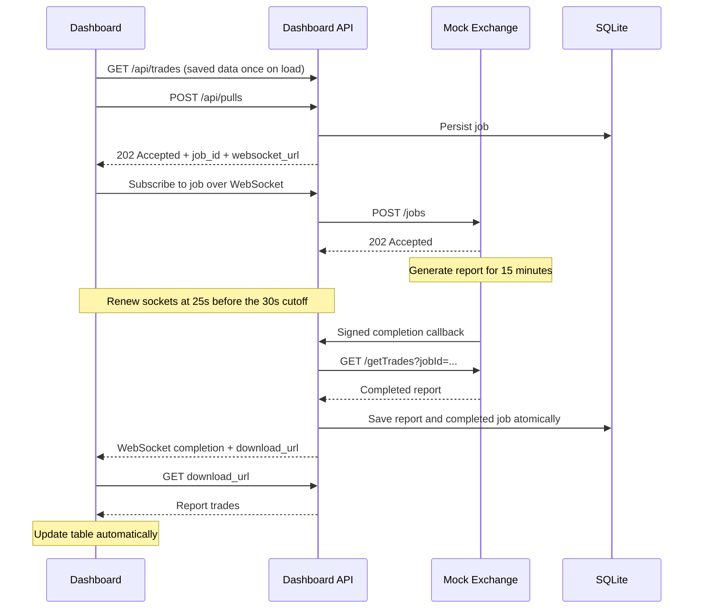

# Tradeflow — BSE Trades Dashboard

A mock exchange and live dashboard for the technical assessment: generating trades takes **15 minutes**, while the network drops connections after **30 seconds**. Saved trades load immediately, and completed reports appear automatically without page refreshes, HTTP polling, or cron jobs.

## Requirements

- **Node.js 24 or newer**, which includes the SQLite API used by this project.
- **npm** (included with Node.js) and a modern browser.
- Available local ports **3000** and **4100**, or alternate ports configured below.

No separate database service or frontend build is required.

```sh
node --version
npm --version
```

## Setup

### 1. Clone the repository

```sh
git clone https://github.com/devops-victim/assessment.git
cd assessment
```

### 2. Install dependencies

```sh
npm ci
```

### 3. Create your configuration

Windows PowerShell:

```powershell
Copy-Item .env.example .env
```

macOS / Linux:

```sh
cp .env.example .env
```

The defaults work without modification. The application loads `.env` automatically.

### 4. Start the application

```sh
npm start
```

This starts both services together:

- Dashboard: **http://localhost:3000**
- Dashboard health: **http://localhost:3000/api/health**
- Mock exchange health: **http://localhost:4100/health**

Keep the terminal open during testing. Press **Ctrl+C** to stop both services.

## Using the dashboard

1. Open the dashboard. With a fresh data directory, the table starts empty.
2. Click **Pull latest trades**. The request immediately returns a job ID while processing continues in the background.
3. Wait the full **15 minutes**. The first pull keeps the table empty until the completed report is ready.
4. A WebSocket completion notification triggers one HTTP report download. **2,000 trades** appear automatically on the open dashboard.
5. Search, filter by symbol, paginate, or export CSV.
6. Start another pull manually. Existing records remain visible while processing; another **2,000 new trades** arrive on completion, bringing the total to **4,000**.

There is no fixed 5,000-trade dataset or automatic next pull. Each job generates a new seeded batch with distinct trade IDs. Only one pull runs at a time; repeated triggers reuse the active job.

Open a second dashboard tab before completion to check that both update automatically. Reloading or reopening the dashboard immediately loads saved trades. Data and unfinished jobs survive server restarts.

## Configuration

Edit `.env`, then restart the server:

```dotenv
PULL_DELAY_MS=900000
PORT=3000
MOCK_PORT=4100
DATA_DIR=./data/jobs
```

| Setting | Default | Meaning |
|---|---|---|
| `PULL_DELAY_MS` | `900000` | Report delay in milliseconds; minimum 15 minutes |
| `PORT` | `3000` | Dashboard HTTP and WebSocket port |
| `MOCK_PORT` | `4100` | Mock exchange HTTP port |
| `DATA_DIR` | `./data/jobs` | SQLite databases and generated callback secret |
| `CALLBACK_SECRET` | Generated locally | Optional shared secret for signed exchange callbacks |

For a **16-minute** pull, set `PULL_DELAY_MS=960000`. Normal startup rejects shorter than 15-minute delays. Jobs already accepted keep their original readiness time.

The **30-second** network cutoff and **25-second** WebSocket renewal are constants in `src/timing.js`. `npm run demo` starts the same full-duration application.

To start empty again without deleting existing data, stop the server, set `DATA_DIR=./data/fresh-review` to a new unused directory, and restart. `.env`, runtime databases, and local callback secrets are excluded from Git.

## Architecture



The durable job separates processing time from HTTP connection time. WebSockets carry small notifications; HTTP carries the completed report. SQLite keeps previous reports immediately available and deduplicates imports. Reconnection replays completion metadata so a disconnected dashboard can recover.

The simulation also caps upgraded WebSocket connections. Physical sockets renew at 25 seconds while the logical job subscription continues for the full report duration. This renewal does not poll HTTP data or status. Requested-job timers and completion callbacks drive processing; there is no cron or automatic pull scheduler.

**Upstream assumption:** the mock adds `POST /jobs` and a signed completion callback alongside the requested `GET /getTrades`. This is not a claim about the real BSE API. An upstream offering only a synchronous 15-minute response needs an asynchronous interface or a worker network path that permits that response.

See [the architecture note](docs/ARCHITECTURE.md) for design and recovery details.

## API reference

| Service | Endpoint | Purpose |
|---|---|---|
| Dashboard | `GET /api/trades` | Initial saved trades, jobs, and timing |
| Dashboard | `POST /api/pulls` | Immediate 202 with job ID and WebSocket URL |
| Dashboard | `WS /live?job_id=<id>` | Job notifications; completion includes `download_url` |
| Dashboard | `WS /live` | Workspace metadata for jobs started in another tab |
| Dashboard | `GET /api/pulls/<id>/trades` | Completed job report; 409 if processing, 404 if unknown |
| Dashboard | `GET /api/direct-pull` | Synchronous-request timeout demonstration |
| Dashboard | `POST /api/exchange-callback` | Signed internal completion callback |
| Dashboard | `GET /api/health` | Health check |
| Mock | `POST /jobs` | Accept report generation; supplied job ID is idempotent |
| Mock | `GET /getTrades?jobId=<ready-id>` | Download completed seeded trades |
| Mock | `GET /getTrades` | Slow synchronous baseline; connection dies at 30 seconds |
| Mock | `GET /health` | Health and configured timing |

Trades include trade ID, client, symbol, quantity, price, and timestamp.

## Testing

### Automated tests

```sh
npm test
```

Tests cover empty startup, immediate acceptance, persistence, callback signatures, duplicate prevention, report isolation, reconnect recovery, multiple dashboards, completion-triggered downloads, and socket timeouts. Isolated tests use shorter injected delays; normal startup retains the real assessment duration.

### Observe the actual 30-second timeout

With the application running, click **Run 30-second timeout test**. The synchronous request waits for the slow mock response, and its connection is destroyed after approximately **30 seconds**. The dashboard displays the measured failure and network event. Saved trades remain available.

### Full 15-minute verification

```sh
npm run test:assessment
```

This starts isolated services, verifies the real 900-second processing duration and 30-second connection reset, and records protocol evidence in `artifacts/walkthrough-events.json`. Allow **at least 15 minutes** for completion.

### Optional browser checks

```sh
npx playwright install chromium
npm run test:browser
```

These also use the full pull duration and save screenshots to `artifacts/`. You can supply an installed Chrome executable through `CHROME_PATH`. Browser checks require an environment that allows Chromium processes.

## Troubleshooting

| Problem | Solution |
|---|---|
| SQLite import or unsupported Node error | Upgrade to Node.js 24 or newer, then run `npm ci`. |
| `EADDRINUSE` on startup | Stop the application occupying the port, or change `PORT` / `MOCK_PORT` in `.env`. |
| Delay validation error | Set `PULL_DELAY_MS` to `900000` or greater. |
| Old trades appear on startup | Saved data is restored automatically. Use a new `DATA_DIR` for an empty run. |
| Configuration changes have no effect | Restart the server. Existing jobs keep their original readiness time. |
| Direct `/getTrades` fails after 30 seconds | This is the intended synchronous failure. Use the dashboard's asynchronous pull. |

## Project structure

```text
public/       Dashboard HTML, CSS, and browser JavaScript
src/          Dashboard API, mock exchange, storage, and timing
test/         Automated tests
scripts/      Browser checks, full-duration recording, and video rendering
docs/         Architecture, walkthrough, and submission materials
.env.example  Configuration template
```

## Deliverables

- [Architecture note and diagram](docs/ARCHITECTURE.md)
- [Captioned video walkthrough](docs/walkthrough.mp4)
- [Recorded walkthrough events](docs/walkthrough-events.json)
- [Walkthrough and screen-recording guide](docs/WALKTHROUGH.md)
- [Submission email draft](docs/SUBMISSION.md)

The video retains actual elapsed timestamps and labels the compressed waiting segment. To generate a new recording, run `npm run walkthrough`. To render it, install Python, Pillow, and opencv-python, then run `python scripts/render-video.py`. Generated artifacts go to `artifacts/`.
