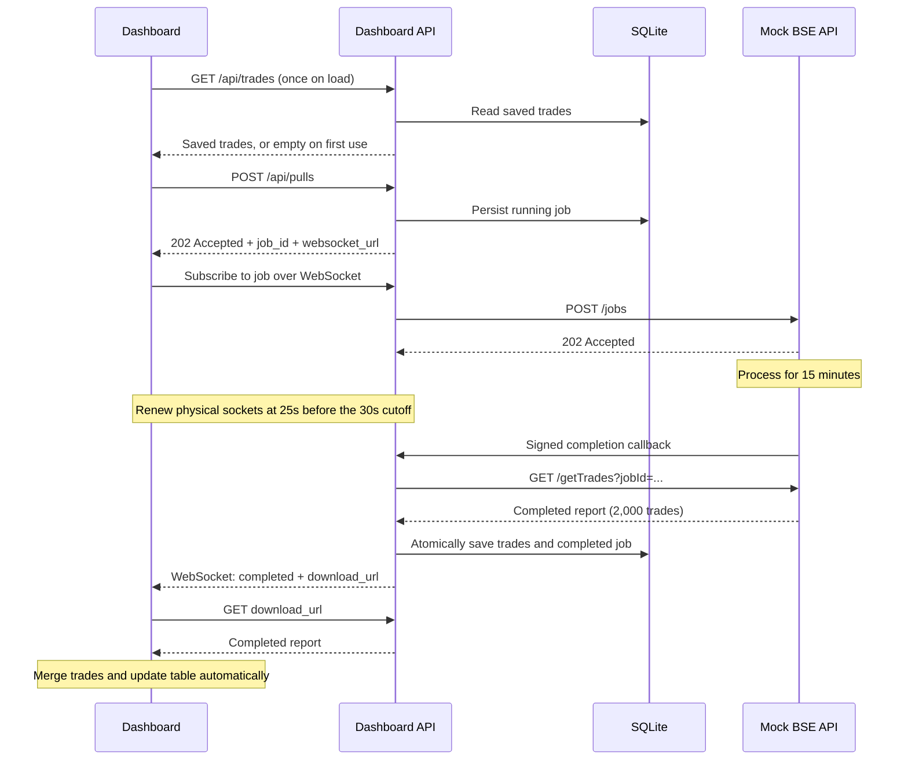

# Architecture Note — BSE Trades Dashboard

## Design

Use a durable asynchronous job for the 15-minute pull, WebSockets for completion notifications, and short HTTP requests to transfer completed reports. The dashboard reads saved trades immediately instead of waiting for the exchange.

## Why this design

- **Avoids long HTTP requests:** job acceptance returns immediately; the 15-minute processing runs independently. HTTP downloads occur only once the report is ready.
- **Keeps the dashboard responsive:** a fresh installation starts empty. Later visits show persisted trades immediately, including during another pull. Each completed job adds 2,000 new trades.
- **Updates without polling:** a signed exchange callback triggers the import, then a WebSocket event triggers the browser's report download. No timed HTTP status requests, cron jobs, or automatic pull scheduler are needed.
- **Recovers from interruptions:** SQLite persists jobs, readiness times, and trades. Reconnecting browsers receive completion metadata again; trade IDs and atomic imports prevent duplicate records. Only one pull runs at a time.
- **Keeps setup small:** the dashboard API and mock exchange run as two local services in one Node.js process, with SQLite and no separate database server.

## Timing and upstream assumption

The default delay is **900,000 ms (15 minutes)**, configurable through `PULL_DELAY_MS` to 15 minutes or longer. The network simulation actually destroys connections at **30 seconds**; the dashboard includes a synchronous-request test that visibly demonstrates this failure. The same cap applies to upgraded WebSocket sockets, so they renew at **25 seconds** while retaining the logical job subscription. Renewing the connection does not restart the report.

The mock explicitly adds `POST /jobs` and a completion callback alongside `GET /getTrades`. This assumes an asynchronous upstream interface; it does not claim that the real BSE API supports these endpoints. If an upstream only provides a synchronous 15-minute response, a worker must have a network path that permits that request, or the upstream interface must change.
