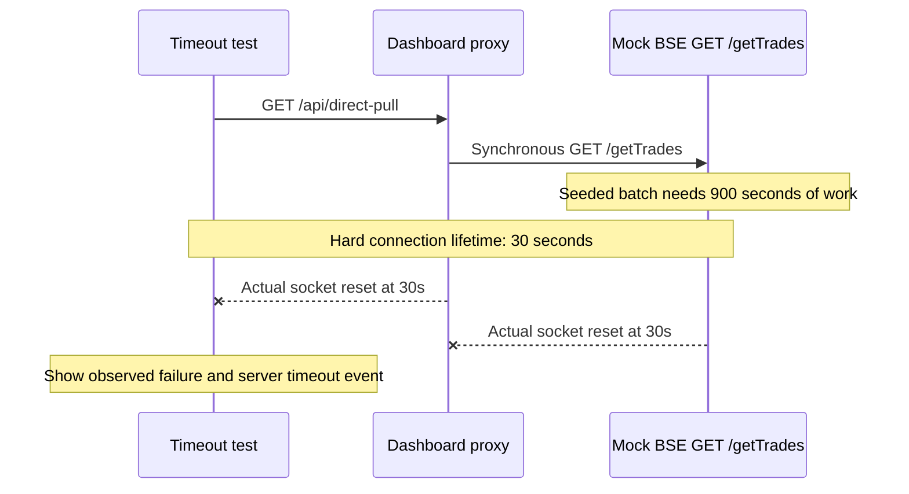

# Architecture: 15-minute work across a 30-second network limit

## Original failure, reproduced



This is a real connection teardown, not a fake JSON timeout or a shorter browser timer. Both HTTP servers attach a lifetime deadline to every accepted socket. The deadline destroys that socket even when it is waiting for a response or has been upgraded to WebSocket. Request/idle timeouts alone do not enforce this condition.

## Working asynchronous flow

```mermaid
sequenceDiagram
    participant UI as Open dashboards
    participant App as Dashboard API
    participant DB as SQLite
    participant BSE as Mock BSE async extension
    UI->>App: WebSocket /live
    App->>DB: Read prior trades and jobs
    App-->>UI: Saved snapshot immediately
    UI->>App: POST /api/pulls
    App->>DB: Persist running job
    App-->>UI: 202 Accepted
    App->>BSE: GET /getTrades?mode=async&jobId=...
    BSE->>BSE: Persist readiness time = now + 900 seconds
    BSE-->>App: 202 Accepted, connection ends
    Note over BSE: Full 15-minute work delay; no held HTTP request
    loop Transport renewal during the pull
        Note over UI,App: Close live socket at 25s, before the 30s hard cap
        UI->>App: Reconnect live subscription
        App-->>UI: Authoritative saved snapshot
    end
    BSE->>App: Signed ready callback after 900 seconds
    App->>BSE: GET /getTrades?jobId=... (ready batch, once)
    BSE-->>App: 200 with seeded trades
    App->>DB: Transaction: insert unique trades, complete job
    DB-->>App: Commit
    App-->>UI: Push completed snapshot automatically
    App-->>BSE: Acknowledge callback
```

## Why this design

Work lifetime and connection lifetime are independent. The browser never owns the import. A saved snapshot is immediately available, and a durable job survives tab closure or process restart. SQLite avoids additional infrastructure for an assessment, supplies unique trade IDs, and atomically commits the imported batch with the job's completion status. A partial unique index permits only one active pull, even with simultaneous triggers.

The exchange stores the actual readiness time. Its one-shot delay cannot publish a pending batch before that timestamp. Restart recovery arms the remaining delay from the stored readiness time; it does not repeat a full 15 minutes or shorten the original job. The app re-dispatches its running job using the same ID; already ready jobs are returned immediately.

The callback is signed with HMAC. On readiness, the app performs one completed-data GET, commits, then pushes. Failed callback delivery uses bounded retries. A one-shot job deadline marks missing completion as a failure while preserving saved trades. No periodic scheduler scans for work or starts imports.

WebSocket is an event subscription, not a status polling loop. Renewing it at 25 seconds avoids the enforced 30-second network reset. Fresh authoritative snapshots on reconnect cover a completion missed during a disconnect. Local elapsed-time counters request no data. Full snapshots are reasonable for a few thousand records; larger systems should use pagination, versioned deltas and resumable event cursors.

## Explicit upstream assumption

The literal synchronous API is retained and **fails** under the stated network restriction. The mock additionally implements `mode=async` and a ready callback to provide a viable interface for the working solution. This is an explicit exchange capability added by the mock, not an undocumented assertion about the real BSE API.

If a real exchange only exposes a synchronous 15-minute HTTP response and every available upstream path always kills that connection after 30 seconds, no client-side architecture can successfully consume that response. An asynchronous exchange export/push capability or a worker outside the restricted network is necessary. Placing the same synchronous GET in a worker on the same network would still fail at 30 seconds.

## Observability and verification

The dashboard displays the actual configured work duration, network limit, elapsed pull time, live connection age/renewal count, direct request countdown and observed timeout. A server-generated timeout event includes the route, connection kind, actual socket lifetime and timestamp. The terminal prints the same event.

Normal startup defaults to 900,000 ms of work, rejects smaller values, and fixes the network limit at 30,000 ms. `npm run demo` no longer shortens time. Longer configured durations are shown truthfully. Fast tests shorten only isolated factory timings; `npm run test:assessment` uses the full real wall-clock delays and records the 30-second failure and 900-second completion.

## Scope

- Two logical HTTP services run in one local process; both bind to loopback. Public deployment would require authentication, TLS, rate limits and configured allowed origins.
- A production multi-instance system would use a shared database, durable queue and event fanout while retaining the same acceptance, readiness, commit and push boundaries.
- HTTP calls have 30-second client bounds in addition to the actual socket cap. Requests on the working path finish quickly and never wait for exchange work.
- Prices and clients are fictional seed data. Production monetary calculations should use decimal values or integer minor units.
- Saved trades and job history persist. Recent-job UI history is bounded; timeout observations are bounded process-local diagnostics.
- Browser rendering is blocked by Windows IPC restrictions in this development sandbox. DOM tests run the actual frontend scripts; the included full-duration Playwright check is available for visual QA outside the sandbox.
